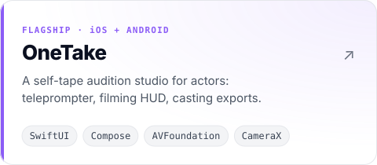
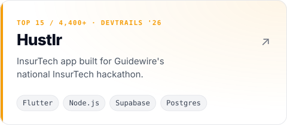
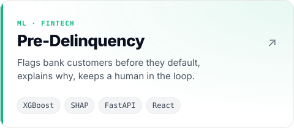
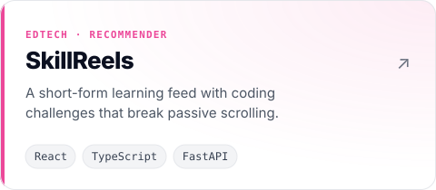
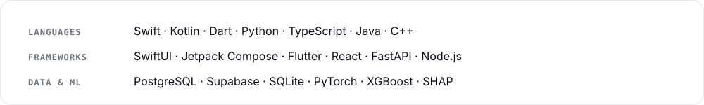

  <picture><source media="(prefers-color-scheme: dark)" srcset="assets/header-dark.svg"/></picture>

  <a href="https://github.com/IneshAg/OneTake-iOS"><picture><source media="(prefers-color-scheme: dark)" srcset="assets/onetake-dark.svg"/></picture></a>
  <a href="https://github.com/IneshAg/Hustlr"><picture><source media="(prefers-color-scheme: dark)" srcset="assets/hustlr-dark.svg"/></picture></a>

  <a href="https://github.com/IneshAg/Pre-Delinquency-Intervention-Engine"><picture><source media="(prefers-color-scheme: dark)" srcset="assets/predelinquency-dark.svg"/></picture></a>
  <a href="https://github.com/IneshAg/SkillReels"><picture><source media="(prefers-color-scheme: dark)" srcset="assets/skillreels-dark.svg"/></picture></a>

  Also: <a href="https://github.com/IneshAg/OneTake-Android">OneTake for Android</a> · <a href="https://github.com/IneshAg/Finsight">Finsight</a> · <a href="https://github.com/IneshAg/CIFAR">CIFAR-10 classifier</a>

  <picture><source media="(prefers-color-scheme: dark)" srcset="assets/stack-dark.svg"/></picture>

  Hacktoberfest Super Contributor · Organizer, Techformers 1.0 (1,900+) · INSPIRE iOS Program

  <a href="https://www.linkedin.com/in/inesh-agarwal/"><b>LinkedIn</b></a> &nbsp;·&nbsp; <a href="mailto:ineshag123@gmail.com"><b>Email</b></a>

