<p align="center">
  
</p>

<p align="center">
  
</p>

<p align="center">
  <a href="https://www.linkedin.com/in/inesh-agarwal/"></a>
  <a href="mailto:ineshag123@gmail.com"></a>
  
</p>

<p align="center">
  
</p>

## 🧠 `whoami`

```yaml
name:      Inesh Agarwal
education: B.Tech Computer Science @ SRMIST Chennai (2024–2028)
focus:     [Native iOS, Android, Flutter, Full-Stack, ML for Fintech]
now:       Shipping OneTake, a self-tape audition studio for actors
open_to:   [Internships, Open Source, Hackathons, Ambitious builds]
motto:     "what if we actually shipped this?"
```

## 🚀 `featured_builds`

<p align="center">
  <a href="https://github.com/IneshAg/OneTake-iOS"></a>
  <a href="https://github.com/IneshAg/Hustlr"></a>
</p>
<p align="center">
  <a href="https://github.com/IneshAg/Pre-Delinquency-Intervention-Engine"></a>
  <a href="https://github.com/IneshAg/SkillReels"></a>
</p>

<p align="center">
  <a href="https://github.com/IneshAg/OneTake-Android"></a>
  <a href="https://github.com/IneshAg/Finsight"></a>
  <a href="https://github.com/IneshAg/CIFAR"></a>
  <a href="https://github.com/IneshAg?tab=repositories"></a>
</p>

## ⚡ `tech_arsenal`

<p align="center">
  
  <br/>
  
  <br/>
  
</p>

## 📊 `live_telemetry`

<p align="center">
  
  
</p>

<p align="center">
  <a href="https://github.com/IneshAg/IneshAg/actions/workflows/activity-graph.yml">
    
  </a>
</p>

<p align="center">
  
</p>

<p align="center">
  
</p>
